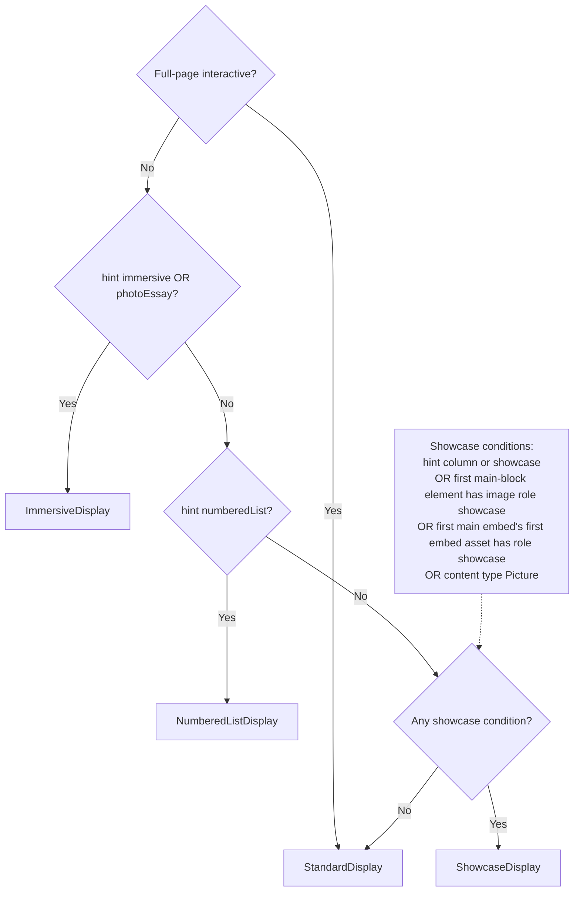
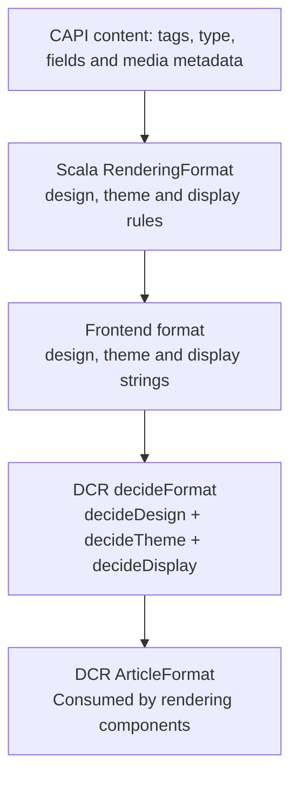

# Rendering format

This guide describes how `CapiModelEnrichment.RenderingFormat` derives presentation metadata from CAPI content. 

## Terminology

| Concern | Implementation | Output definitions |
| --- | --- | --- |
| Predicate helpers and selection rules | [CapiModelEnrichment.scala](../client/src/main/scala/com.gu.contentapi.client/utils/CapiModelEnrichment.scala) | |
| Design: which template to use | `RenderingFormat.design` | [Design.scala](../client/src/main/scala/com.gu.contentapi.client/utils/format/Design.scala) |
| Theme: pillar or special branding | `RenderingFormat.theme` | [Theme.scala](../client/src/main/scala/com.gu.contentapi.client/utils/format/Theme.scala) |
| Display: presentation of the design | `RenderingFormat.display` | [Display.scala](../client/src/main/scala/com.gu.contentapi.client/utils/format/Display.scala) |
| Behaviour and precedence tests | [CapiModelEnrichmentFormatTest](../client/src/test/scala/com.gu.contentapi.client/model/utils/CapiModelEnrichmentTest.scala) | |

Design, theme and display are selected independently; the client does not render a page. Tags describe content (for example, tone or series membership), while display hints request presentation. Both can participate in the selection rules, so a hint is not an unconditional template override.

Each method uses `getFromPredicate` to take the **first matching predicate in list order**, or its default if none matches. Tag order within `content.tags` does not determine precedence.

- [Design rules](#design-rules)
- [Theme rules](#theme-rules)
- [Display rules](#display-rules)
- [Downstream rendering](#downstream-rendering)
- [Legacy design type](#legacy-design-type)
- [Updating these rules](#updating-these-rules)

## Design rules

The diagram follows the predicate list in `design`. `tag` means an exact tag ID match; `hint` means `fields.displayHint`; `type` means `content.type`, not a type tag.

### Shared predicates

- **Hosted:** `content.isHosted` is true.
- **Weekend read:** tag `news/series/the-saturday-read` or `news/series/the-sunday-read`.
- **Immersive weekend read:** a weekend-read tag and hint `immersive`. This skips the analysis rule, but other higher-priority rules can still win.
- **Full-page interactive:** content type `Interactive` and either:
  - hint `fullPageInteractive`; or
  - hint `immersive` and `fields.creationDate` strictly before **2025-01-01 00:00 UTC**. A missing creation date does not qualify.

### Design selection

Each highlighted block is a resulting design, with its criteria feeding into it. Numbers show precedence: **if multiple designs qualify, the lowest number wins**. Each criteria box must be satisfied in full; `OR` indicates alternatives. Article is the fallback only when none of the other 29 rules match.

```mermaid
flowchart LR
    c01["isHosted = true<br/>AND type = Article"] --> d01["1. HostedArticleDesign"]
    c02["isHosted = true<br/>AND type = Video"] --> d02["2. HostedVideoDesign"]
    c03["isHosted = true<br/>AND type = Gallery"] --> d03["3. HostedGalleryDesign"]

    c04["type = Interactive<br/>AND hint = fullPageInteractive"] --> d04["4. FullPageInteractiveDesign"]
    c04legacy["type = Interactive<br/>AND hint = immersive<br/>AND creationDate before 2025-01-01 00:00 UTC"] --> d04
    c05["type = Interactive"] --> d05["5. InteractiveDesign"]
    c06["tag info/newsletter-sign-up"] --> d06["6. NewsletterSignupDesign"]
    c07["tag type/gallery"] --> d07["7. GalleryDesign"]
    c08["type = Picture"] --> d08["8. PictureDesign"]
    c09["tag type/audio"] --> d09["9. AudioDesign"]
    c10["tag type/video"] --> d10["10. VideoDesign"]
    c11["tag type/crossword"] --> d11["11. CrosswordDesign"]

    c12a["tag tone/reviews"] --> d12["12. ReviewDesign"]
    c12b["tag tone/livereview"] --> d12
    c12c["tag tone/albumreview"] --> d12
    c13["tag tone/obituaries<br/>AND NOT tag tone/letters"] --> d13["13. ObituaryDesign"]
    c14["tag tone/analysis<br/>AND NOT immersive weekend read<br/>(see definitions above)"] --> d14["14. AnalysisDesign"]
    c15["tag tone/explainers"] --> d15["15. ExplainerDesign"]
    c16["tag tone/comment"] --> d16["16. CommentDesign"]
    c17["tag tone/letters"] --> d17["17. LetterDesign"]
    c18["hint = photoEssay"] --> d18["18. PhotoEssayDesign"]
    c19["tag tone/interview"] --> d19["19. InterviewDesign"]
    c20["tag tone/recipes"] --> d20["20. RecipeDesign"]
    c21["tag tone/editorials"] --> d21["21. EditorialDesign"]
    c22["tag tone/quizzes"] --> d22["22. QuizDesign"]

    c23["tag tone/minutebyminute<br/>AND fields.liveBloggingNow = true"] --> d23["23. LiveBlogDesign"]
    c24["tag tone/minutebyminute<br/>AND fields.liveBloggingNow is false or missing"] --> d24["24. DeadBlogDesign"]
    c25a["tag news/series/the-saturday-read"] --> d25["25. WeekendEssayDesign"]
    c25b["tag news/series/the-sunday-read"] --> d25
    c26["tag tone/features"] --> d26["26. FeatureDesign"]
    c27["tag tone/matchreports"] --> d27["27. MatchReportDesign"]
    c28["tag tone/timelines"] --> d28["28. TimelineDesign"]
    c29["tag tone/profiles"] --> d29["29. ProfileDesign"]
    c30["No preceding rule matches"] --> d30["Default: ArticleDesign"]

    classDef design fill:#dbeafe,stroke:#1d4ed8,color:#172554,stroke-width:3px;
    class d01,d02,d03,d04,d05,d06,d07,d08,d09,d10,d11,d12,d13,d14,d15,d16,d17,d18,d19,d20,d21,d22,d23,d24,d25,d26,d27,d28,d29,d30 design;
```

### Weekend-read and analysis interaction

The analysis predicate excludes content that has both an `immersive` hint and a weekend-read series tag. This allows selection to continue to the weekend-essay rule; it does not give weekend reads unconditional priority.

Assuming no other earlier design rule matches:

| Inputs | Design | Display |
| --- | --- | --- |
| Weekend-read tag + `tone/analysis` + hint `immersive` | `WeekendEssayDesign` | `ImmersiveDisplay` |
| Weekend-read tag + `tone/analysis`, no display hint | `AnalysisDesign` | `StandardDisplay` |
| `tone/analysis` + hint `immersive`, no weekend-read tag | `AnalysisDesign` | `ImmersiveDisplay` |

Other rules retain their precedence. For example, an immersive weekend read tagged `tone/reviews` still selects `ReviewDesign`. Immersive presentation and weekend-essay design are separate choices, not competing values of one property.

## Theme rules

These rows follow the predicate list in `theme`. The first match wins.

| Priority | Criteria | Theme |
| --- | --- | --- |
| 1 | A tag matches `specialReportTags`, or its salted hash matches `hashedSpecialReportTags` | `SpecialReportTheme` |
| 2 | A tag matches `specialReportAltTags`, or its salted hash matches `hashedSpecialReportAltTags` | `SpecialReportAltTheme` |
| 3 | Tag `tone/advertisement-features` | `Labs` |
| 4 | `pillarName` is `Opinion`, or it is `News` with tag `tone/comment` or `tone/letters` | `OpinionPillar` |
| 5 | `pillarName` is `Sport` | `SportPillar` |
| 6 | `pillarName` is `Arts` | `CulturePillar` |
| 7 | `pillarName` is `Lifestyle` | `LifestylePillar` |
| Default | No preceding rule matches | `NewsPillar` |

The special-report tag sets and hashing logic live in `theme`; consult those definitions rather than maintaining a second copy of the tag lists here.

## Display rules

This diagram follows the predicate list in `display`. A full-page interactive uses `StandardDisplay` even when it has the legacy immersive hint.

The image check uses `content.blocks.main.elements.headOption.imageTypeData.role`.
The embed check uses the first element in `content.elements` with relation `main` and type `Embed`, then its first asset of type `Embed`, checking `typeData.role`.
Missing data does not satisfy either check.

## Downstream rendering

Frontend constructs a format from the client's design, theme and display, then serialises their names as strings. DCR's `decideFormat` converts those strings to its own enums; `decideDesign` does not rerun the tag predicates above.

For example, `WeekendEssayDesign` plus `ImmersiveDisplay` maps to DCR's `ArticleDesign.WeekendEssay` plus `ArticleDisplay.Immersive`. Consumers can apply further overrides, so this guide describes the client's output rather than guaranteeing the final visual layout. Think of it as signals of intention, DCR ultimately holds responsibility for the layout/visual.

Check the consumer versions when investigating production behaviour:

- [Frontend format construction and serialisation](https://github.com/guardian/frontend/blob/main/common/app/model/meta.scala).
- [DCR format conversion and defaults](https://github.com/guardian/dotcom-rendering/blob/main/dotcom-rendering/src/lib/articleFormat.ts).

## Legacy design type

`immersive` normally changes **display**, not **design**. For example, an immersive interview can be `InterviewDesign` + `ImmersiveDisplay`.

The older `designType` method is a separate classification. It returns `Immersive` for hint `immersive`, unless advertisement-feature, match-report, or quiz tags take precedence. The design diagram above describes `design`, not that legacy method.

